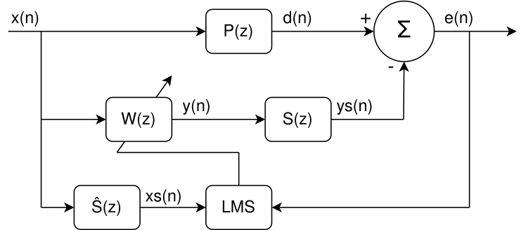
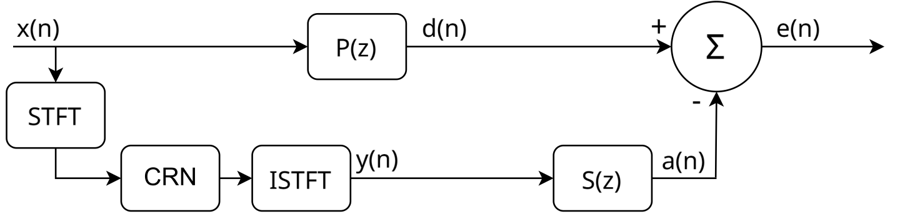
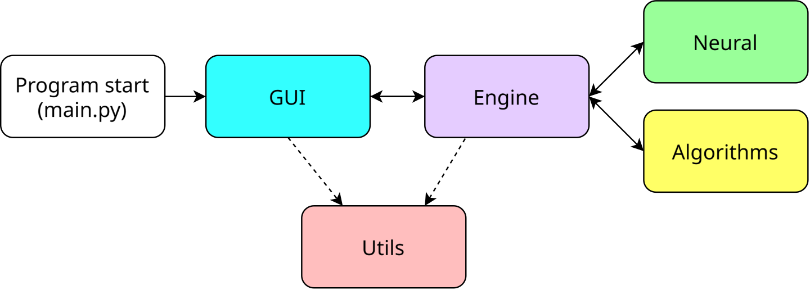
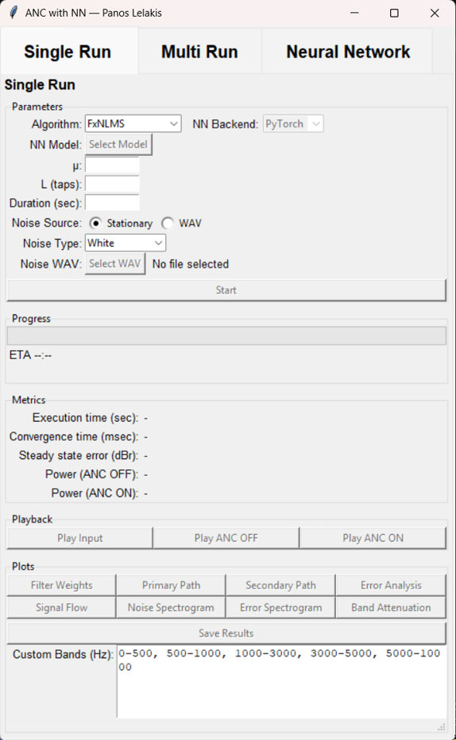

# Active Noise Control with Neural Networks

**ANC-with-NN** is a Python simulation application developed for my diploma thesis at the University of Patras. It combines adaptive filtering and convolutional recurrent neural networks in a graphical environment for studying active noise control.



*FxLMS signal flow: P(z) is the primary path, W(z) the controller, S(z) the secondary path, and e(n) the residual error.*



*Neural ANC inference: STFT → CRN → ISTFT generates the control signal. After secondary-path filtering, the residual error is e(n) = d(n) − a(n). Model weights remain fixed during inference.*

## Features

- **Adaptive methods:** LMS, NLMS, FxLMS and FxNLMS.
- **Neural models:** a Deep ANC-based CRN and a simplified configurable CRN, implemented in PyTorch.
- **Experiments:** single simulations, parameter sweeps and parallel execution.
- **Training tools:** audio preprocessing, model training, validation and checkpoint saving.
- **Analysis and export:** performance metrics, signal plots, CSV/JSON summaries, PDF figures and output audio.
- **ONNX support:** model export and inference through ONNX Runtime.



*Software overview: the GUI interacts with the engine, which connects the neural modules and adaptive algorithms. Shared utilities support both the GUI and engine.*

## Installation

Use a Python environment with Tkinter available. Install the dependencies and launch the application:

```bash
git clone --depth 1 https://github.com/PanosLelakis/ANC-with-NN.git
cd ANC-with-NN
python -m pip install -r "python/libraries used.txt"
python python/main.py
```

Run the application from the repository root, named **ANC-with-NN**. If downloading a ZIP, rename the extracted folder accordingly.

Dependencies are listed in [python/libraries used.txt](python/libraries%20used.txt). Tkinter and audio playback may require additional system packages on some platforms.

## Basic Usage

The interface has three tabs:

- **Single Run:** configure and inspect an individual simulation.
- **Multi Run:** compare algorithms and explore filter parameters across multiple noise signals.
- **Neural Network:** preprocess data, train and validate models, and export ONNX files.



*Single Run interface for configuring a simulation and accessing its metrics, plots, audio playback and result export.*

For a quick adaptive example, open **Single Run** and select:

| Setting | Value |
| --- | --- |
| Algorithm | FxNLMS |
| Noise Source / Type | Stationary / White |
| μ | 0.01 |
| L (taps) | 256 |
| Duration (sec) | 1 |

Click **Start**, inspect the results with **Error Analysis** and **Band Attenuation**, and use **Save Results** to export them. This is an illustrative one-second simulation, not a guaranteed performance result.

Outputs are saved under **results/**. For the exported attenuation metric, negative values indicate noise reduction and positive values indicate increased residual power.

## Pretrained Model

**[Download best.pt from OneDrive](https://1drv.ms/u/c/a525b8895717ea45/IQDmLQ7n-31fQo6J7J3Pj2jQATSQmjIxa5mvkEtkc64s89w?e=g5mXGy)**

1. Download **best.pt** and place it in **models/pretrained/**, creating the folder if needed.
2. In **Single Run**, select **Algorithm → Neural Network** and **NN Backend → PyTorch**.
3. Click **Select Model**, choose **best.pt**, select a noise signal and duration, and click **Start**.

The checkpoint contains the model configuration and weights, so architecture settings are loaded automatically. No training is required to try the pretrained model.

For ONNX inference, select the checkpoint in **Neural Network → Validation** and click **Export ONNX**. Then select the **best.pt** checkpoint and **ONNX** backend in Single Run or Multi Run. Keep **best.pt** and the generated **best.onnx** together; the application uses both files.

## Training

Training and validation audio is supplied under **dataset/trimmed_selection_train_validate/**, in **train/** and **validate/** subfolders.

In **Neural Network**, select the dataset and processed-data folders, click **Preprocess Dataset**, configure the available model and training settings, and click **Start Training**. Under **Validation**, click **Select** to choose a checkpoint, then **Run Validation** to evaluate it on the processed validation data.

The **Original** architecture requires **16,000 Hz** audio. Processed validation data must match the checkpoint's sampling rate.

## Scientific Basis

The neural implementation is based on **Hao Zhang and DeLiang Wang**, “Deep ANC: A deep learning approach to active noise control,” *Neural Networks*, 141, 1–10, 2021. [DOI](https://doi.org/10.1016/j.neunet.2021.03.037).

My contribution includes the simulation framework, GUI, adaptive-filter integration, training and evaluation workflows, parameter studies, and result visualization.

The project evaluates simulated acoustic systems. Results depend on the noise signals, acoustic paths, model configuration and experimental settings.

## License

Available for personal study and non-commercial academic evaluation under the [Academic Evaluation Source License](LICENSE). See the license for the complete terms.
